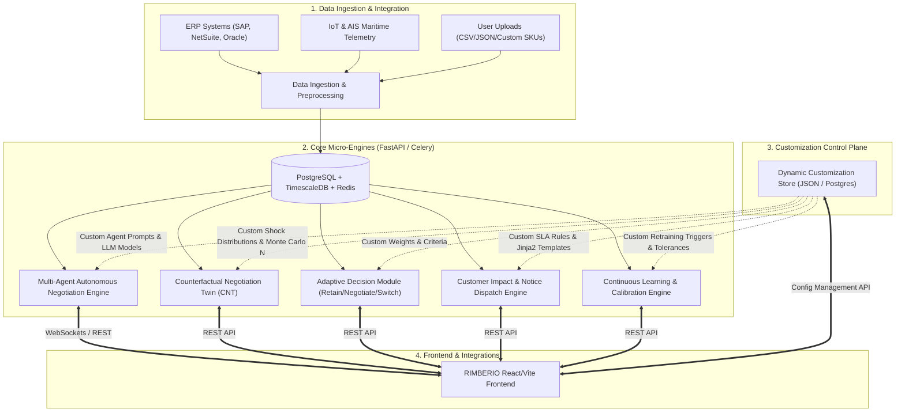
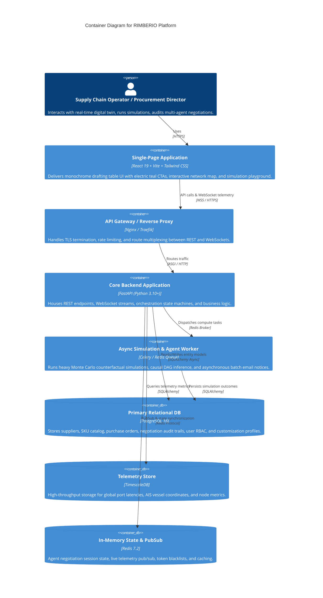
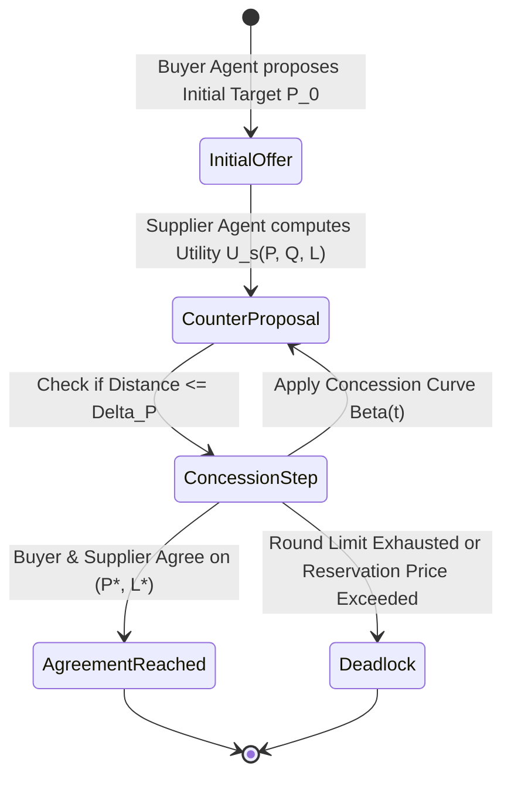
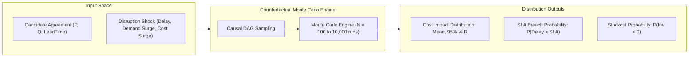
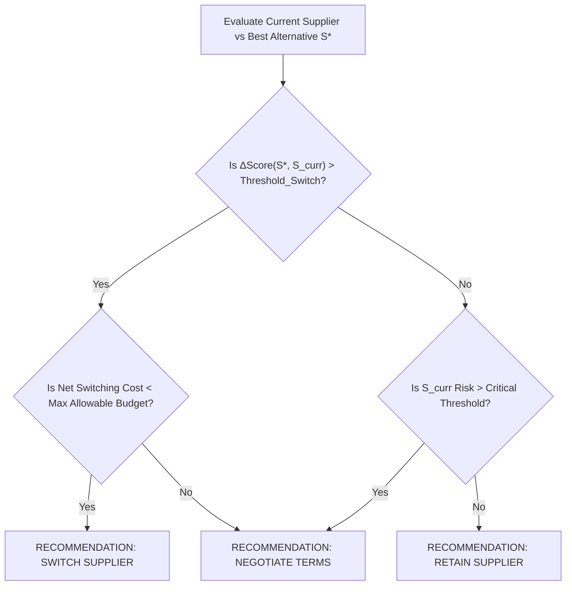
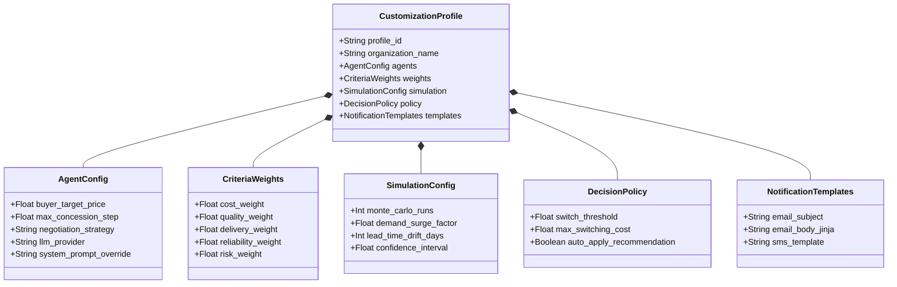
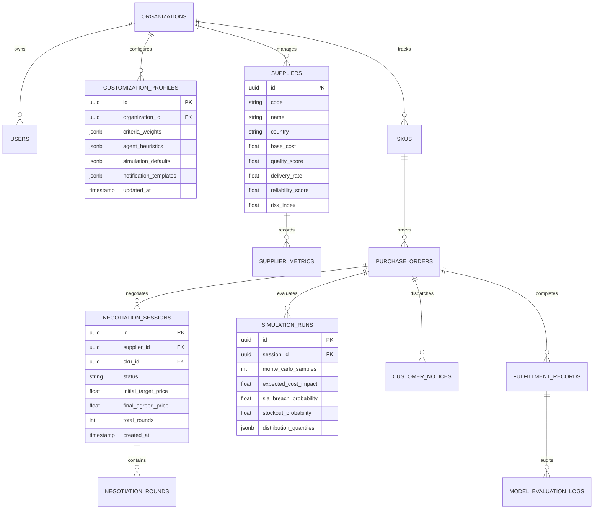

# RIMBERIO AI Supply Chain Twin — Enterprise Backend System Architecture
> **Design Specification: Fully Customizable Multi-Agent Counterfactual Digital Twin Platform**

---

## 1. Executive Summary & Design Vision

**RIMBERIO** is an enterprise autonomous supply chain digital twin that bridges multi-agent autonomous negotiation, causal counterfactual simulation, adaptive supplier switching, and automated customer transparency.

This document specifies the **Enterprise Backend Architecture** engineered for **Full Customization**. Every layer—from agent negotiation behavioral heuristics and LLM prompts, to causal perturbation distributions, multi-criteria evaluation weights, notification dispatch templates, and online model recalibration loops—is exposed via dynamic configuration schemas and REST/WebSocket APIs.

---

## 2. System Architecture & C4 Container Specification

### 2.1 C4 Container Diagram

---

## 3. Core Engine Specifications

### 3.1 Multi-Agent Autonomous Negotiation Engine
The negotiation engine coordinates autonomous interactions between five distinct agent personas:
1. **Buyer Agent**: Represents enterprise procurement. Minimizes total landed cost, enforces strict quality standards, and protects SLA delivery lead-times.
2. **Supplier Agent**: Represents candidate vendors (e.g., Apex Global, Murata). Protects margins, manages capacity allocations, and leverages volume commitments.
3. **Logistics Agent**: Analyzes maritime, air, and freight corridor congestion (e.g., Suez, Panama, Malacca Strait) and estimates real-time transit delta.
4. **Customer Impact Agent**: Audits client commitments, identifies downstream delivery risks, and drafts transparent customer notifications.
5. **Operations Lead / Admin**: Supervises model policy, verifies concession boundaries, and triggers human-in-the-loop overrides.

#### Customizable Negotiation Heuristics
Negotiation protocols support both **Parametric Heuristic Strategies** and **LLM-Driven Strategies**:

- **Time-Dependent Concession Curves**:
  $$P_s(t) = P_{\min} + (P_{\max} - P_{\min}) \cdot \left(1 - \left(\frac{t}{T_{\max}}\right)^{1/\beta}\right)$$
  - $\beta > 1$ (**Boulware / Stubborn**): Firm pricing until final rounds.
  - $\beta = 1$ (**Linear**): Steady, predictable concession.
  - $\beta < 1$ (**Conceder**): Fast concessions early in the negotiation.
- **LLM Persona Prompt Customization**:
  Admins can supply custom system prompts, temperature settings, and constraint guardrails per agent (e.g. OpenAI GPT-4o, Anthropic Claude 3.5 Sonnet, or local Ollama/Llama-3).

---

### 3.2 Counterfactual Negotiation Twin (CNT) Engine
The Counterfactual Negotiation Twin answers causal *"What-If"* questions:
$$\text{Outcome} = \mathbb{E}\big[\text{Impact} \mid do(\text{Supplier}=S_k), \text{Scenario}=D\big]$$

#### Customizable Simulation Controls
- **Monte Carlo Sample Size ($N$)**: Customizable from 100 to 10,000 iterations.
- **Stochastic Perturbation Distributions**:
  - Lead time variance: $\Delta L \sim \text{Poisson}(\lambda)$ or Log-Normal.
  - Freight surcharges: $\Delta C_{\text{freight}} \sim \mathcal{N}(\mu, \sigma^2)$.
  - Demand surges: Multiplier $M_D \sim \text{Beta}(\alpha, \beta)$ or Uniform.
- **Confidence Intervals**: 90%, 95%, 99% Value-at-Risk (VaR).

---

### 3.3 Adaptive Decision Module (Retain / Negotiate / Switch)
Evaluates candidate suppliers using Multi-Criteria Decision Analysis (MCDA) and classifies the optimal enterprise policy.

#### 1. Dynamic Weighted Scoring Formulation
$$\text{Score}(S_i) = w_{\text{cost}} \cdot \tilde{C}_i + w_{\text{quality}} \cdot Q_i + w_{\text{delivery}} \cdot D_i + w_{\text{reliability}} \cdot R_i + w_{\text{risk}} \cdot (1 - K_i)$$
Where:
- $\tilde{C}_i$ is the normalized inverse cost.
- $Q_i \in [0, 1]$ is quality rating.
- $D_i \in [0, 1]$ is on-time delivery rate.
- $R_i \in [0, 1]$ is vendor reliability history.
- $K_i \in [0, 1]$ is geographical & geopolitical risk index.
- $\sum w = 1.0$ (Fully customizable via frontend sliders).

#### 2. Decision Classification Boundary

---

### 3.4 Customer Impact & Notification Automation Engine
When a disruption or supplier transition affects delivery dates or inventory buffers:
1. **Impact Analysis**:
   - Matches active purchase orders and customer order lines with impacted SKUs.
   - Computes expected delay in days ($\Delta \text{Days} = \text{ETA}_{\text{new}} - \text{ETA}_{\text{promised}}$).
   - Flags SLA breaches and monetary penalty liabilities.
2. **Customizable Notice Template Engine**:
   - Supports Jinja2 / Liquid templates with variable tags (`{{ customer_name }}`, `{{ order_id }}`, `{{ sku_name }}`, `{{ revised_eta }}`, `{{ reason }}`).
   - Multi-channel connectors: SMTP Email, SMS (Twilio), Webhooks, and ERP notifications.

---

### 3.5 Continuous Learning & Online Feedback Engine
Implements Section IV-D & IV-F of the research paper:
- **Retrospective Ingestion**: Collects actual realized delivery dates, actual landed unit costs, and actual defect rates upon order fulfillment.
- **Error Metric Calculation**:
  $$\text{MAE} = \frac{1}{M}\sum_{j=1}^M |\text{Actual}_j - \text{Predicted}_j|$$
  $$\text{RMSE} = \sqrt{\frac{1}{M}\sum_{j=1}^M (\text{Actual}_j - \text{Predicted}_j)^2}$$
- **Confusion Matrix Tracking**:
  - Compares the system's recommendation (**Retain**, **Negotiate**, **Switch**) against the retrospectively optimal business choice.
- **Dynamic Model Recalibration**:
  - Auto-updates prior risk parameters and calibration weights when MAE exceeds a user-defined threshold $\epsilon$.

---

## 4. Full Customization Framework & Schema Specifications

The customization architecture is organized into five configuration domains:

---

## 5. REST & WebSocket API Schema Specification

### 5.1 Customization Endpoints (`/api/v1/customization`)
- `GET /api/v1/customization/profile`: Retrieve active organizational customization profile.
- `PUT /api/v1/customization/profile`: Update complete customization settings.
- `PATCH /api/v1/customization/weights`: Update multi-criteria evaluation weights in real time.
- `PATCH /api/v1/customization/agents`: Update agent negotiation behavioral parameters and LLM settings.
- `PATCH /api/v1/customization/simulation`: Update Monte Carlo simulation sample sizes and default perturbation shocks.
- `POST /api/v1/customization/reset-defaults`: Reset profile back to factory research baselines.

### 5.2 Multi-Agent Negotiation Endpoints (`/api/v1/agents`)
- `POST /api/v1/agents/negotiate/start`: Start autonomous negotiation session for specific SKU and Supplier.
- `POST /api/v1/agents/negotiate/step`: Execute next round of multi-agent bids and concessions.
- `POST /api/v1/agents/negotiate/force-concession`: Inject human-in-the-loop concession override.
- `GET /api/v1/agents/negotiate/{session_id}/transcript`: Fetch complete transcript and offer history.
- `WS /api/v1/agents/negotiate/{session_id}/live`: WebSocket stream for live bidirectional negotiation chat.

### 5.3 Counterfactual Digital Twin Endpoints (`/api/v1/simulation`)
- `POST /api/v1/simulation/counterfactual`: Run Monte Carlo counterfactual simulation.
- `GET /api/v1/simulation/scenarios`: List standard pre-configured disruption scenarios (Suez, Panama, Semiconductor allocation, etc.).
- `POST /api/v1/simulation/scenarios/custom`: Create a user-defined custom disruption event.

### 5.4 Supplier & Decision Endpoints (`/api/v1/suppliers` & `/api/v1/decision`)
- `GET /api/v1/suppliers`: Fetch list of suppliers with weighted composite scores.
- `POST /api/v1/suppliers`: Register new vendor profile.
- `POST /api/v1/decision/evaluate`: Run Retain / Negotiate / Switch recommendation classifier for an active SKU.
- `POST /api/v1/decision/apply`: Commit decision and generate downstream procurement actions.

### 5.5 Customer Impact Endpoints (`/api/v1/customer-impact`)
- `GET /api/v1/customer-impact/orders`: List customer purchase orders impacted by current supply disruptions.
- `POST /api/v1/customer-impact/notify/batch`: Render Jinja2 templates and dispatch automated notices to affected customers.
- `POST /api/v1/customer-impact/preview-template`: Render notice preview with mock order variables.

### 5.6 Learning Feedback Endpoints (`/api/v1/learning`)
- `GET /api/v1/learning/metrics`: Get live model accuracy, MAE, RMSE, and error telemetry.
- `GET /api/v1/learning/confusion-matrix`: Fetch confusion matrix for Retain / Negotiate / Switch classifications.
- `POST /api/v1/learning/recalibrate`: Trigger online model recalibration with historical fulfillment data.

---

## 6. Database Schema Design (PostgreSQL / TimescaleDB)

---

## 7. Implementation Roadmap & Production Deployment

1. **Phase 1: Modular Monolith Foundation**:
   - Python 3.10+ FastAPI framework with async route handlers.
   - Pydantic v2 schemas for all customization payloads and validation.
   - In-memory thread-safe state store with JSON file persistence for immediate plug-and-play local development.
2. **Phase 2: Full Analytical Engines**:
   - NumPy & SciPy Monte Carlo counterfactual simulation module.
   - Configurable Multi-Agent state machine with Boulware / Conceder concession curves and fallback heuristic agents.
   - MCDA TOPSIS & Weighted Scoring decision classifier.
   - Jinja2 customer notice templating engine.
   - Scikit-learn confusion matrix and regression metrics (MAE/RMSE) evaluator.
3. **Phase 3: Production Distributed Scale**:
   - PostgreSQL 16 persistence with Alembic migrations.
   - Redis queue with Celery for background simulation jobs.
   - Docker Compose deployment packaging both Frontend Vite dev server and FastAPI backend server.
