# RIMBERIO AI Supply Chain Twin — Kaggle Dataset Integration Guide
> **Reference Schemas, Field Mapping, and Ingestion Pipeline for Standard Kaggle Supply Chain Datasets**

---

## 1. Supported Kaggle Datasets

RIMBERIO natively ingests, maps, and runs machine learning models on the two primary benchmark supply chain datasets hosted on Kaggle:

### Dataset A: DataCo Smart Supply Chain for Big Data Analysis
- **Kaggle Source**: [DataCo Smart Supply Chain Dataset](https://www.kaggle.com/datasets/shashwatwork/dataco-smart-supply-chain-for-big-data-analysis)
- **Scale**: 180,519 rows × 53 features
- **Format**: `DataCoSupplyChainDataset.csv`
- **Primary Role in RIMBERIO**: Powers the **Continuous Learning Engine (Step 9)**, lead-time drift models, and **Customer Impact Agent (Steps 7 & 8)**.

### Dataset B: Supply Chain Analysis (by Harshit Shankhdhar)
- **Kaggle Source**: [Supply Chain Analysis](https://www.kaggle.com/datasets/harshitshankhdhar/supply-chain-analysis)
- **Scale**: Multi-category SKU, vendor pricing, defect rates, and logistics routes
- **Format**: `supply_chain_data.csv`
- **Primary Role in RIMBERIO**: Powers the **Buyer Agent**, **Supplier Agent**, and **Adaptive Decision Module (Steps 1, 2, 5 & 6)**.

---

## 2. Feature Mapping Matrix to RIMBERIO Multi-Agent Framework

```mermaid
flowchart TD
    subgraph Kaggle_DataCo["Kaggle DataCo Dataset (53 Cols)"]
        D1["Days for shipping (real)"]
        D2["Days for shipment (scheduled)"]
        D3["Late_delivery_risk"]
        D4["Benefit per order"]
        D5["Customer Segment"]
        D6["Order Region & Market"]
    end

    subgraph Kaggle_SupplyChain["Kaggle Supply Chain Analysis (24 Cols)"]
        S1["Supplier name & Location"]
        S2["Manufacturing costs"]
        S3["Defect rates"]
        S4["Lead times & Shipping times"]
        S5["Production volumes"]
        S6["Routes & Transportation modes"]
    end

    subgraph Rimberio_Agents["RIMBERIO Multi-Agent Engines"]
        AGENT_BUYER["Buyer Agent (Target Pricing & Concession)"]
        AGENT_SUP["Supplier Agent (Margin & Cost Curve)"]
        AGENT_LOG["Logistics Agent (Transit Delay & Corridor Variance)"]
        AGENT_CIA["Customer Impact Agent (SLA Penalties & Notices)"]
        AGENT_ADMIN["Admin Auditor (Retain/Negotiate/Switch Classifier)"]
        ENGINE_CNT["Counterfactual Negotiation Twin (Causal Monte Carlo)"]
    end

    D1 & D2 --> AGENT_ADMIN
    D1 & D2 --> AGENT_LOG
    D3 & D5 --> AGENT_CIA
    D4 --> ENGINE_CNT

    S1 & S2 --> AGENT_BUYER
    S2 & S5 --> AGENT_SUP
    S3 & S4 --> AGENT_ADMIN
    S6 --> AGENT_LOG
```



---

## 3. Kaggle DataCo Field Mapping Details

| Kaggle Column | RIMBERIO Mapped Attribute | Target Agent / Module | Mathematical / Logical Transformation |
|---|---|---|---|
| `Days for shipping (real)` | `actual_lead_time_days` | Continuous Learning Engine | Ground truth for calculating Mean Absolute Error ($\text{MAE}$) and Root Mean Squared Error ($\text{RMSE}$). |
| `Days for shipment (scheduled)` | `predicted_lead_time_days` | Logistics Agent | Baseline transit commitment against which delay drift is evaluated. |
| `Late_delivery_risk` | `late_delivery_flag` (0 or 1) | Customer Impact Agent | Triggers automated SLA penalty calculation if `1`. |
| `Customer Segment` | `customer_tier` | Customer Impact Agent | Maps `Corporate` → Enterprise Tier 1 (1.5%/day penalty), `Home Office` → Commercial (0.8%/day), `Consumer` → Standard (0.4%/day). |
| `Order Item Total` / `Sales` | `order_value` | Customer Impact Agent | Landed monetary value used to compute contractual penalty exposure. |
| `Benefit per order` | `order_profit` | Counterfactual Twin (CNT) | Used to assess counterfactual margin loss during simulated disruptions. |
| `Shipping Mode` | `shipping_mode` | Logistics Agent | Evaluates carrier performance: Standard Class, First Class, Second Class, Same Day. |

---

## 4. Kaggle Supply Chain Analysis Field Mapping Details

| Kaggle Column | RIMBERIO Mapped Attribute | Target Agent / Module | Mathematical / Logical Transformation |
|---|---|---|---|
| `Supplier name` | `name` & `code` | Supplier Workspace | Creates distinct vendor profile IDs (`SUP-KAG-001`, `SUP-KAG-002`, etc.). |
| `Manufacturing costs` | `unit_cost` | Buyer & Supplier Agents | Baseline for vendor asking quotes and reservation floor prices. |
| `Defect rates` | `quality_score` | Adaptive Decision Module | $$\text{Quality Score} = \max(50.0, 100.0 - (\text{Defect Rate} \times 10.0))$$ |
| `Lead times` | `lead_time_days` | Logistics & Decision Engines | Evaluates supplier responsiveness; impacts delivery score and risk index. |
| `Production volumes` | `capacity_monthly` | Supplier Agent | Sets monthly production quotas and bulk volume tier discounts. |
| `Location` | `country` | Geopolitical Risk Model | Determines transit corridors and maritime chokepoints crossed. |
| `Routes` | `chokepoints_crossed` | Logistics Agent | Maps shipping paths to choke corridors (e.g. Suez, Panama, Malacca Strait). |

---

## 5. Ingestion API Endpoints

### 5.1 Uploading Kaggle DataCo Dataset
```http
POST /api/data/upload-kaggle-dataco
Content-Type: multipart/form-data
Body: file=@DataCoSupplyChainDataset.csv
```
**Response**:
```json
{
  "status": "SUCCESS",
  "fulfillment_records_ingested": 500,
  "customer_orders_ingested": 30,
  "total_rows_parsed": 180519,
  "dataset_type": "Kaggle DataCo Smart Supply Chain"
}
```

### 5.2 Uploading Kaggle Supply Chain Analysis Dataset
```http
POST /api/data/upload-kaggle-supplychain
Content-Type: multipart/form-data
Body: file=@supply_chain_data.csv
```
**Response**:
```json
{
  "status": "SUCCESS",
  "extracted_suppliers": 5,
  "total_rows_parsed": 100,
  "dataset_type": "Kaggle Supply Chain Analysis"
}
```

### 5.3 Fetching Kaggle Summary & Pre-loaded Samples
- `GET /api/data/kaggle/summary`: Overview of supported Kaggle datasets and telemetry counts.
- `GET /api/data/kaggle/dataco-sample`: Sample 50 rows conforming to Kaggle DataCo 53-column structure.
- `GET /api/data/kaggle/supplychain-sample`: Sample 50 rows conforming to Kaggle Supply Chain Analysis.
